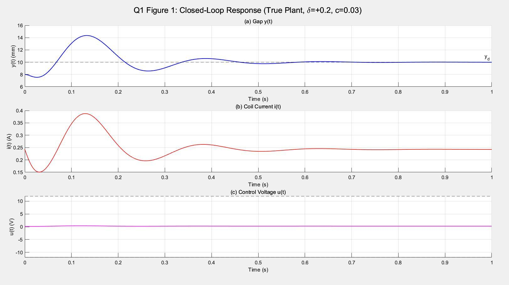
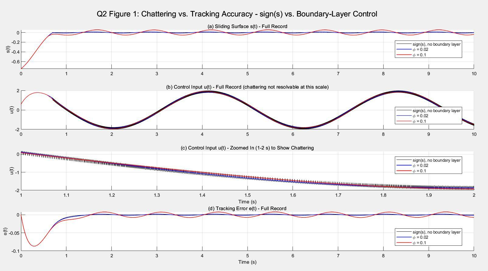
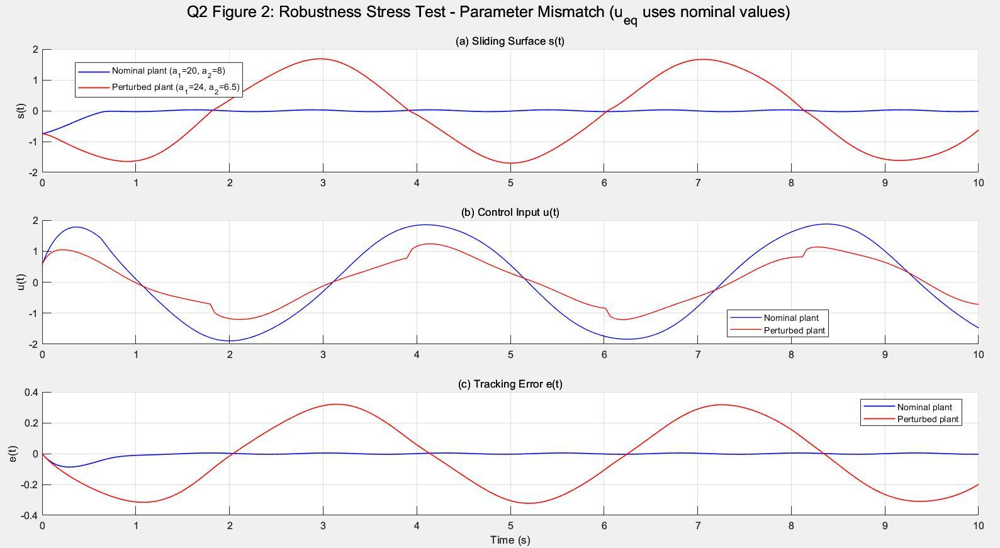
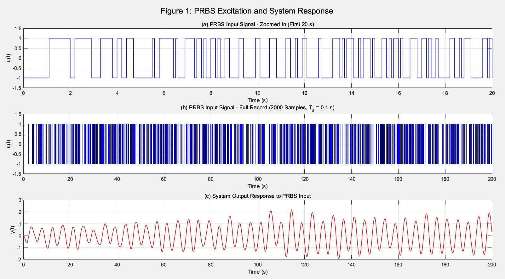
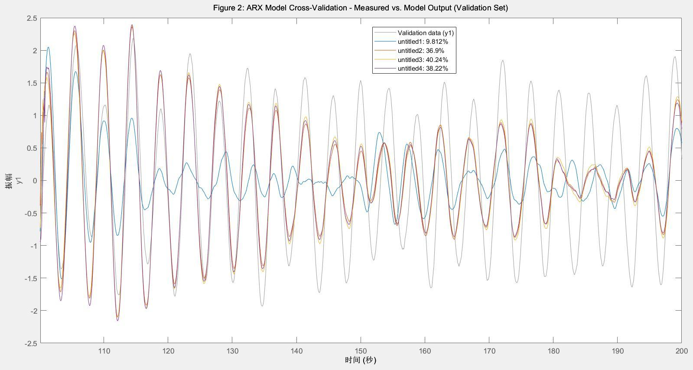
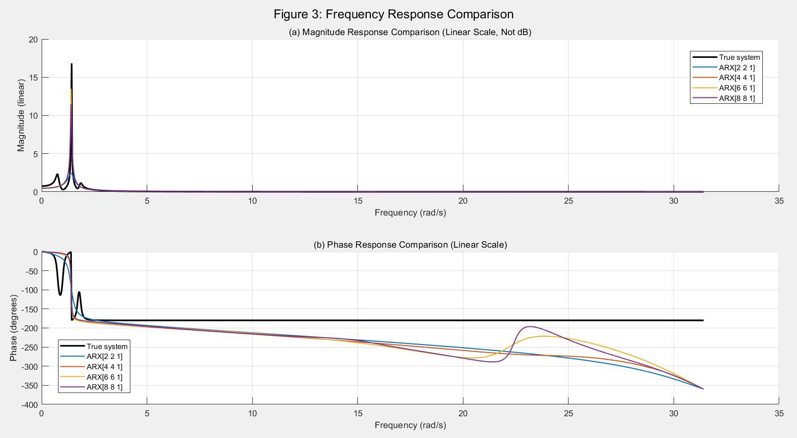

# Assignment 1 Simulation Results

The figures below were extracted from the ELECTENG 704 Assignment 1 submission. Numerical values are transcribed from its result tables and discussion.

## Q1(f) Magnetic levitation

With the initial gap at 8 mm and the target at 10 mm, the nonlinear closed-loop simulation settled in about 0.6 s. The reported peak gap was about 14.3 mm and the steady-state gap error about 3.6 µm. The discussion reports about 0.39 V peak control voltage against a 12 V limit. The adjacent table instead lists a value of 0.28 A under “Peak u”, so that entry is not used as a voltage measurement.

## Q2(c) Chattering versus tracking accuracy

| Switching law | Chattering index | Sliding-surface zero crossings | Steady-state RMS tracking error |
| --- | ---: | ---: | ---: |
| Discontinuous sign law | ≈111.5 | ≈5,573 | ≈0.00005 |
| Saturation, boundary layer 0.02 | ≈1.94 | ≈14 | ≈0.0013 |
| Saturation, boundary layer 0.10 | ≈1.95 | ≈14 | ≈0.0054 |

Both boundary layers substantially reduced chattering. The wider layer gave a larger RMS tracking error.

## Q2(d) Parameter mismatch

With the boundary layer set to 0.05, the nominal plant produced a steady-state RMS tracking error of approximately 0.003. Changing the plant coefficients from (20, 8) to (24, 6.5) while retaining the nominal controller increased the reported error to approximately 0.22.

## Q3 ARX identification

A 2,000-sample PRBS input was applied at a sample time of 0.1 s. The first 1,000 samples were used for estimation and the remaining 1,000 for validation.

| ARX order [na, nb, nk] | Validation fit |
| --- | ---: |
| [2, 2, 1] | 9.81% |
| [4, 4, 1] | 36.9% |
| [6, 6, 1] | 40.24% |
| [8, 8, 1] | 38.22% |

The sixth-order model had the highest validation fit. The models located the dominant resonance near 1.4 rad/s, while underestimating its magnitude.

